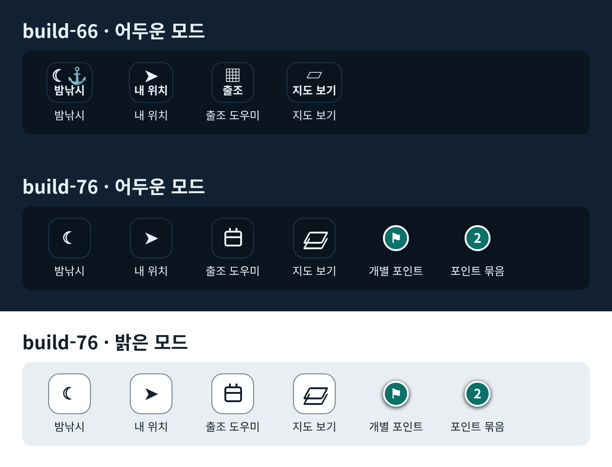

# FishMap 지도 아이콘 설계도 · 2026-11-25

그림은 build-66과 build-76의 앱 HTML에서 Chromium으로 렌더링한 실제 버튼과 핀이다. 비교 그림의 버튼 아래 이름은 설명을 위해 붙였다. build-76의 지도 도구 본체는 글자 없이 표시된다. 숫자 2는 실제 렌더링한 포인트 묶음의 예이며 포함된 지점 수에 따라 달라진다. 운영체제에 따라 달·화살표 글리프 모양은 조금 다를 수 있다. [앱 코드](../app/src/main/assets/index.html) · [인수인계](인수인계_2026-11-25.md)

## 지도 도구 M2

현행 왼쪽부터 밤낚시, 내 위치, 출조 도우미, 지도 보기 순이다. 터치 영역은 각 46×44 CSS px, 모서리 반경 12px이다. 보이는 기호는 장식으로 처리하고 버튼 자체에 접근성 이름과 툴팁을 둔다.

| 위치 | build-66의 디자인 | build-67 이후의 디자인 | 동작과 상태 |
|---|---|---|---|
| 1 · `nightBtn` | 달·닻 + ‘밤낚시’ | 초승달 `☾` | 밤낚시 화면을 토글한다. 켜지면 붉은 테두리로 표시하고 `aria-pressed`를 갱신한다. 일반 밝기 모드 선택은 설정 화면을 사용한다. |
| 2 · `locBtn` | 방향 화살표 + ‘내 위치’ | 방향 화살표 `➤` | 첫 터치는 내 위치를 찾는다. 같은 선택 상태에서 다시 누르면 위치 따라가기를 켜고, 다시 누르거나 지도를 직접 움직이면 따라가기를 끈다. 따라가는 중에는 화살표의 회전·밑줄과 접근성 이름이 바뀐다. |
| 3 · `planBtn` | 격자 `▦` + ‘출조’ | 윤곽 달력 `.calendarIcon` | 날짜별 계획 탭을 연다. 같은 도우미에 추천·계획·기록 탭이 있다. |
| 4 · `layersBtn` | 한 장 `▱` + ‘지도 보기’ | 겹친 두 장 `.layersIcon` | 지도 종류와 흐름선·항내 추정·위성 수온·낚시 포인트 등 표시 항목이 있는 지도 보기 시트를 연다. |

달력은 19×17px의 둥근 윤곽과 2px 선, 두 고리로 그린다. 겹친 지도는 두 평행사변형을 엇갈리게 그린다. 두 도형 모두 CSS의 `currentColor`로 다크·라이트 테마 색을 따른다.

500ms 길게 누르면 도구 이름 말풍선을 약 1.5초 동안 표시한다. 버튼 또는 내부 기호의 텍스트 선택과 터치 메뉴를 막고, 길게 누른 뒤 이어지는 클릭으로 모드를 전환하지 않도록 처리한다. 접근성 이름과 키보드 동작을 위한 버튼 구조는 유지한다. [지도 도구 변경 diff](https://github.com/eastman0407/FishMap/commit/8f9a6a7)

## 아이콘을 이렇게 정한 이유

- 사용자는 지도 위 버튼에서 글자를 빼고 출조 버튼의 뜻을 알아보기 쉽게 해달라고 했다. 달력 윤곽은 날짜별 계획을 여는 동작과 연결하고, 겹친 지도는 지도 종류와 표시 레이어를 여는 동작을 나타낸다. 버튼 이름은 접근성 이름과 길게 눌렀을 때의 말풍선에 남겨 작은 화면에서도 의미를 확인할 수 있게 했다.
- 낚시 포인트에는 청록색 깃발을 썼다. 즐겨찾기 별과 보라색 조류예보 숫자는 이미 지도에서 각각 다른 의미를 가진다. 확대하지 않은 지도에서는 가까운 핀을 숫자로 묶어 물살을 볼 공간을 확보한다. 개별 핀 터치는 포인트 설명을 열고, 조류예보 숫자 부근의 터치는 바다 위치 선택으로 전달한다는 기존 사용자 요구를 유지했다.
- 밝은 모드에는 배경이 밝은 위성영상에서도 버튼의 위치를 찾을 수 있도록 윤곽선을 선명하게 했다. 브라우저에서 대비와 조작을 확인했으며, 햇빛이 강한 환경에서의 가독성은 실기기 확인이 남아 있다.

## 지도 안 표식과 상태

| 표식 | 보이는 형태 | 역할과 터치 |
|---|---|---|
| 지도 중심 | 흰 십자 + 어두운 외곽선 | 카메라 중심을 표시한다. 검색 바로 아래 지도 중심 지명과 한 쌍이다. 터치는 지도로 전달한다. |
| 내 위치 | 파란 점과 GPS 정확도 범위 | 실제 내 위치를 나타낸다. 도구 줄의 화살표는 내 위치로 이동시키는 버튼이다. |
| 낚시 포인트 | 청록색 원 안의 흰 깃발 `⚑` | build-69부터 사용한다. 원은 28×28px, 흰 테두리 2px이며 44×44px 핀 영역 중앙에 있다. 탭하면 위치·설명·월별 조과를 열고 지도 쪽 클릭을 중단한다. |
| 낚시 포인트 묶음 | 같은 원 안에 포인트 수 | 화면 좌표의 52px 격자로 가까운 점을 묶는다. 일반 배율에서 탭하면 두 단계 확대하고, 최대 배율에서는 포인트 목록을 여는 경로를 쓴다. |
| 조류예보 지점 | 보라색 바탕에 방향·유속 | 기존 지점 예보 표식이다. 바다 선택을 방해하지 않도록 숫자 표식의 터치는 통과시킨다. |
| 상단 카드 페이지 | 8px 윤곽 점과 채운 활성 점 | build-67부터 최대 두 페이지를 표시한다. 한 페이지 이하면 페이지 점을 숨긴다. |

밝은 모드에서 지도 도구와 검색의 일반 테두리는 `#75828d`, 활성 상태 테두리는 `#0b7a70`, 활성 바탕은 `#e1f4f0`이다. 야간 테마에서는 밤낚시 활성 상태의 붉은 테두리를 구분한다. [앱 코드](../app/src/main/assets/index.html)
