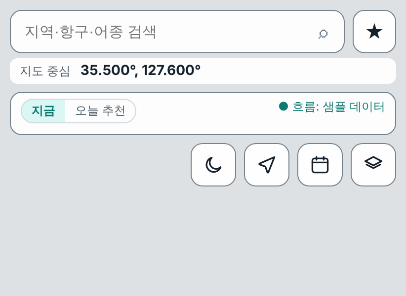
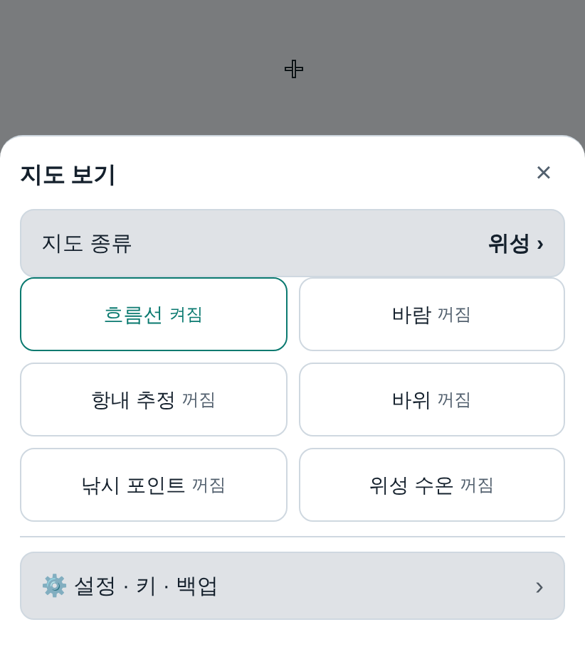
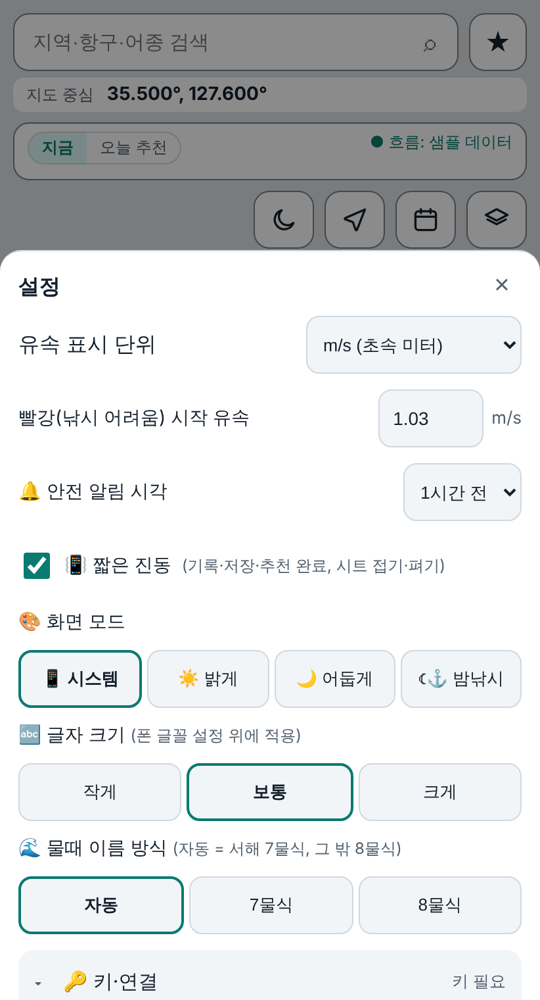

# 바다흐름지도 화면·기능 이름표

기준 형상: **build-77 (v1.76)**. 이미지는 `tools/make_nametags.py`로 앱 HTML을 Chromium 렌더해 만든다(화면이 바뀌면 다시 돌려 커밋 — 형상관리 규칙 6). 바다·지명은 시험용 대체 타일이라 실제 위성영상과 다르다.

전체 규칙·좌표·동작은 [형상관리](../형상관리.md)의 '화면·기능 이름표' 요약(M·P·L·F 코드)을 따른다.

## 1. 메인 화면 (M)

- **M1** 검색줄(지역·항구·어종) + 즐겨찾기 ★ · 지도 중심 지명 줄
- **M2** 지도 도구 네 아이콘 — 밤낚시(초승달) · 내 위치(위치 화살표) · 출조 도우미(달력) · 지도 보기(겹친 지도). build-77에서 같은 1.8px 윤곽 SVG로 통일. 내 위치는 4상태(기본·찾는 중·현위치 이동·따라가기), 화살표 방향 고정.
- **M3** 지금 카드 — 지금/오늘 추천 전환, 샘플/실데이터 배지, 물·날씨 칩(쪽 넘기기). build-77에서 데이터가 늦게 와도 페이지가 튀지 않게 고정.

## 2. 지도 보기 시트 (P1)

- **지도 종류**(위성/일반) + 켜고 끄는 도구 6개: 흐름선 · 바람 · 항내 추정 · 바위 · 낚시 포인트 · 위성 수온 · 맨 아래 **⚙ 설정 · 키 · 백업** 줄. build-77에서 큰 글씨·좁은 폭에서도 테두리가 안 닿게 반경·간격을 다듬음.

## 3. 설정 (P2)

- 유속 표시 단위 · 빨강(낚시 어려움) 시작 유속 · 🔔 안전 알림 시각 · 📳 짧은 진동 · 🎨 화면 모드
- **🔤 글자 크기 (작게·보통·크게)** — build-77 추가. 글자만 커지고 지도·터치 범위는 그대로. 폰 시스템 글꼴 위에 적용. 기본 보통.
- 🌊 물때 이름 방식 · 🔑 키·연결 등
- 🔑 키·연결 안: 공공데이터 키 · 브이월드 키 · **수산과학원 수온 키** (build-93 추가, 선택 — 섬·만 안쪽 수온을 국립수산과학원 실측으로 보정. 키 있으면 묶음 요약에 '· 수산과학원')

## 코드 요약 (형상관리 '화면·기능 이름표'에서)

- **M** 메인: M1 검색·지명 · M2 도구 네 아이콘 · M3 지금 카드
- **P** 창: P1 지도 보기 · P2 설정 · P3~ 출조 도우미 탭 등
- **L** 지도 표시물: L1 흐름선 · L2 항내 추정 · L3 조류예보 지점 · L4 조석 기준점 · L5 바위 · L6 추천 핀 · L7 기록 핀 · L8 갯벌 등
- **F** 기능: F01 유속 예보 · F02 항내 추정 · F06 조석 · F07 물때 · F08 바위 잠김 · F10 수온 · F11 파고·비 등
